# Emberwild

**An original creature-bonding RPG that runs in your browser.** Pick a partner, explore a rain-soaked forest and a pitch-black crystal cave, bond with wild creatures, outwit the mysterious Hollow Veil and take on Warden Corra for the Cinder Sigil. Then head east to the Brinemark Coast: paddle across a tidal marsh, ride the gale lanes of a storm-swept ridge, rescue Warden Maren and earn the Tide Sigil.

▶ **Play it: https://zerochance1907.github.io/emberwild/**

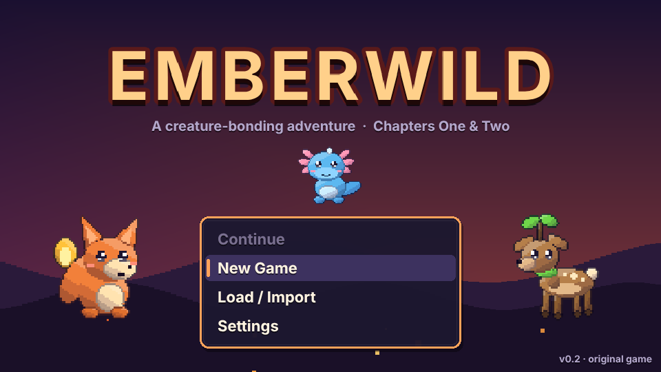

| | |
|---|---|
| 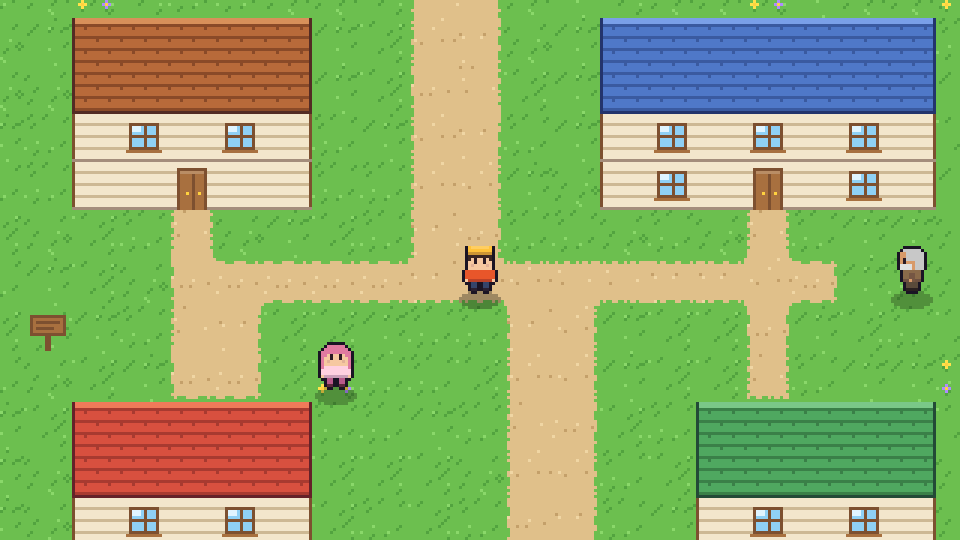 | 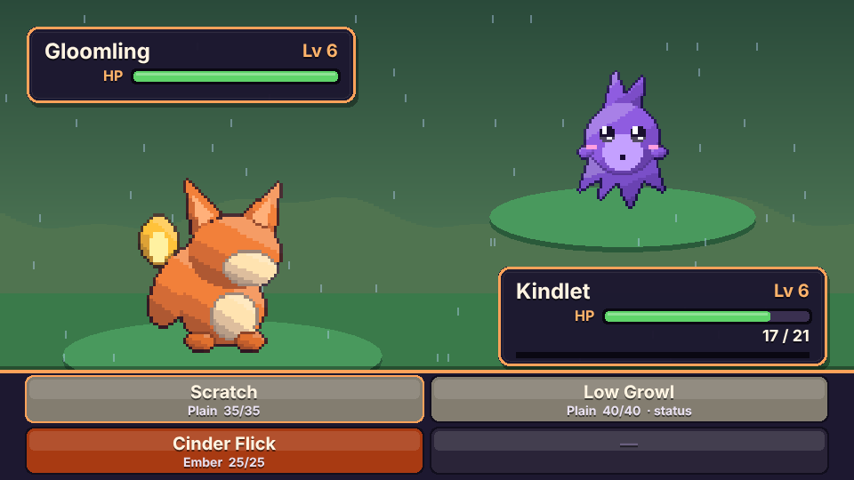 |
| 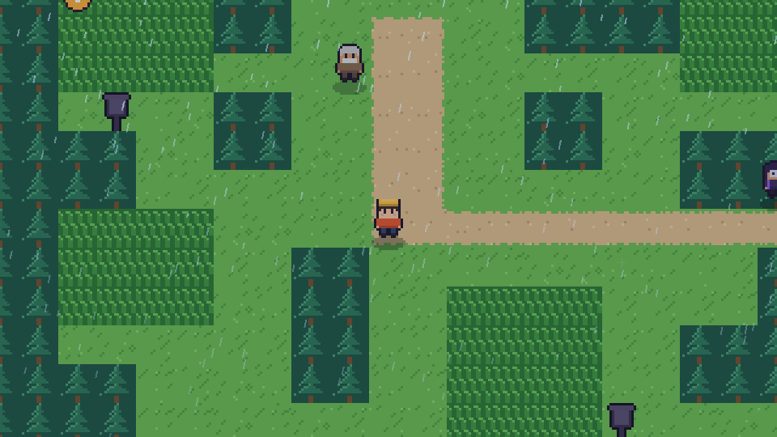 | 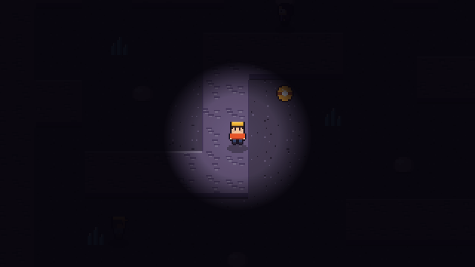 |
| 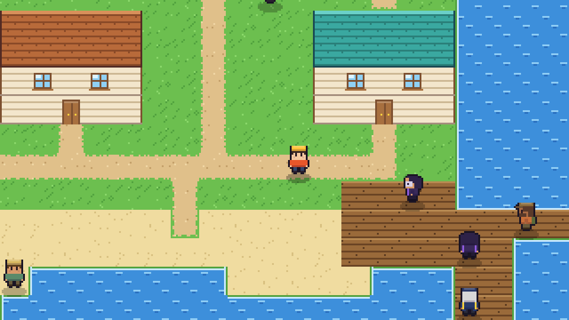 | 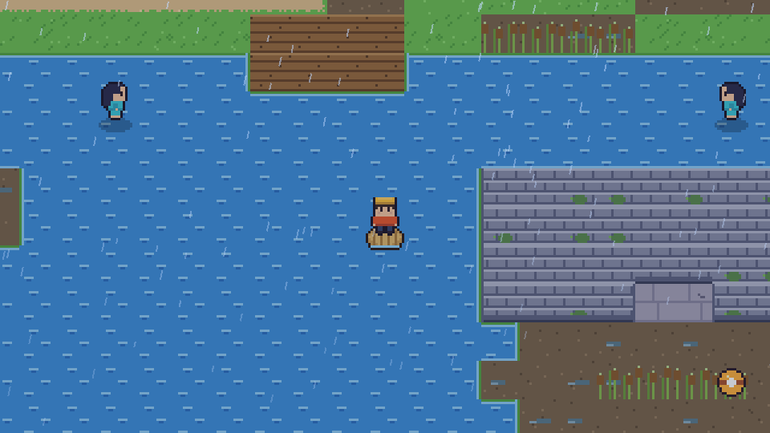 |
| 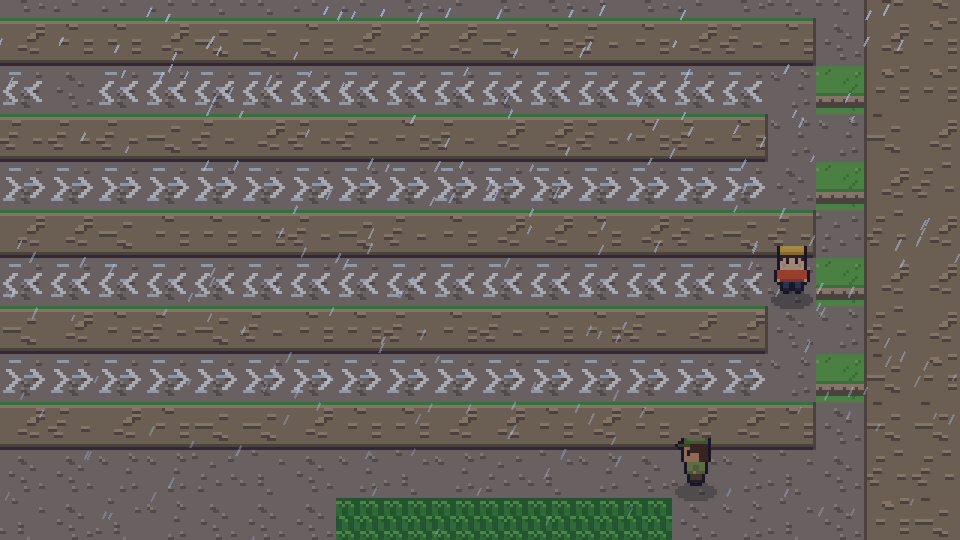 | 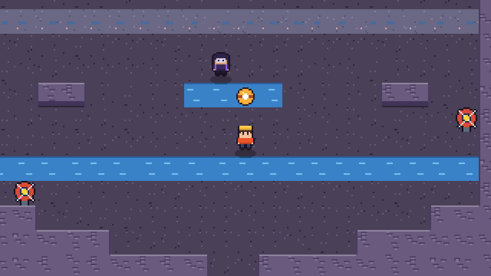 |
| 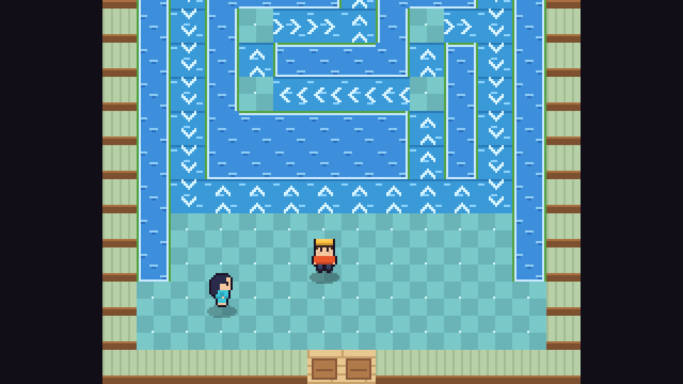 | 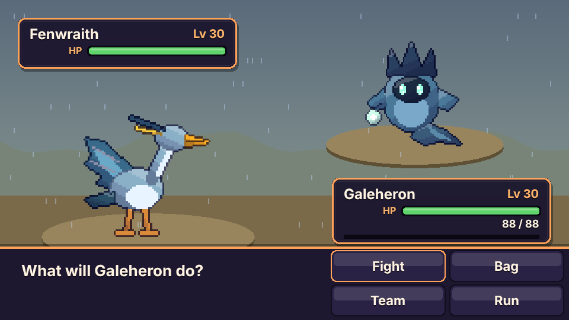 |

**Chapter One** (about 1–2 hours) has a village, two routes, a forest with a light puzzle and hidden items, a dark cave dungeon and a town with the first Warden.

**Chapter Two** (about 2–3 hours) continues from Warden Corra's victory. The rockslide on Cindervale's east road is cleared, and Saltwind Road leads to the port town of **Gullhaven**. From there you cross **Mirefen Marsh** on a reed Driftboard to the ruined **Starfall Observatory**, where Veil Admin Vesper has built a lens that steals lightning from a storm. With the storm broken, the ferry carries you to **Stormcrest Ridge** and its gale lanes, then down into **Tidewrack Grotto**, a dungeon of tide valves, to rescue Warden Maren. Finish by solving the current maze of **Tidewater Hall** and battling Maren for the Tide Sigil. After that, the **Tidewatch Spire** opens for a post-game battle streak.

## Controls

| Action | Keyboard | Gamepad | Touch |
|---|---|---|---|
| Move | Arrow keys / WASD | D-pad / left stick | On-screen D-pad |
| Confirm / talk | Z, Space, Enter | A | A button, or tap |
| Back | X, Backspace | B | B button |
| Run (hold) | Shift | X / RB | RUN button |
| Menu | Esc, M | Start | MENU button |

Every key can be remapped under **Settings → Remap keys**. Hold *Back* to fast-forward text.

## Features

- **36 original creatures** across 8 types (Ember, Tide, Sprout, Gale, Stone, Spark, Shade, Fae), each with stats, a learnset, a Wildlog entry and evolution lines. Two lines have three stages (Pipwhisk → Wadewing → Galeheron, Fizzkid → Ramblast → Cragthunder), and the rare Squallion roams the coast. All sprites (front, back and icon) are drawn in code.
- **79 moves** (physical, special and status) and **5 status conditions**: burned, blighted, jolted, drowsy and dazed.
- **Turn-based battles** with speed order and priority, accuracy, critical hits, same-type bonus, stat stages, switching, items, fleeing and catching with Bond Stones (with shake animation). There's also XP, level-ups, move learning with a replace prompt, and an evolution scene.
- **Trainer AI** that scores moves by damage, KO potential, type matchups and status value, heals when in danger and switches out of bad matchups.
- **A story in two chapters** with a rival (Kip, three battles), the Hollow Veil's Agent Nyx and Tempest Admin Vesper, two Wardens, 37 trainers with line-of-sight challenges, three side quests (Old Bram's lost lantern, Fisher Wade's Ribboneel, Keeper Ysolde's star log) and a stats screen at the end of each chapter.
- **Systems:** starter choice, a team of 6 plus storage, bag, shops, Hearth healing, Wildlog (seen/bonded), and autosave plus 3 manual slots with export/import save codes. Saves from Chapter One load and continue straight into Chapter Two.
- **Chapter Two systems:**
  - **Lure Reed fishing:** face water, cast, and press Confirm the moment the "!" appears. Each area has its own catches.
  - **Driftboard:** paddle across deep water, which has its own wild creatures.
  - **Held items:** eight type charms plus Moss Wrap, Mend Berry, Clear Leaf, Stubborn Shell, Swift Feather and Lucky Scale. Give and take them from the team screen.
  - **Nestkeeper's day-care:** creatures train as you walk. Two that share a type may lay an egg, which hatches into the line's first stage with the best IVs of both parents.
  - **Tidewatch Spire:** a post-game streak of battles against generated level-30+ teams, with no items allowed and a prize every third win.
  - **The roaming Squallion:** it moves every time you change map, keeps its HP between meetings and bolts after a turn or two.
- **Puzzles:** lantern lighting in Whisperwood, gale lanes on Stormcrest Ridge, tide valves in Tidewrack Grotto and a current maze in Tidewater Hall. A pure-logic solver in the tests proves every push and tide puzzle can be solved and can never trap you.
- **Modern feel:** smooth tile movement and running, camera easing, a day/night cycle, rain in Whisperwood and Mirefen, thunderstorms with lightning on Stormcrest Ridge, a lantern-lit dark cave, and animated water, grass, reeds, wind and crystals. Battles have hit flashes, screen shake, eased HP bars, damage numbers and particles for each type.
- **Accessibility and quality of life:** reduced-motion mode, text speed, battle speed, volume, remappable keys, touch controls and gamepad support.
- **Audio:** an original chiptune soundtrack of 20 tracks, synthesized live with WebAudio by a tiny step sequencer. Chapter One has title, town, route, forest, cave, Hearth, battle, trainer, Veil, Warden, victory and ending. Chapter Two adds Saltwind Road, Gullhaven harbour, marsh, observatory, ridge, grotto, the Spire and a theme for Admin Vesper. There are also code-generated sound effects (gusts, splashes, valves, thunder) and a unique cry for every creature. There are no audio files.

## Development

```bash
npm install
npm run dev        # local dev server
npm test           # Vitest unit tests (battle engine, saves + migration, maps, puzzles, balance sim, music data)
npm run e2e        # Playwright smoke tests (run `npm run build` first)
npm run build      # typecheck + production build into dist/
```

Built with TypeScript, Vite and Phaser 3 (exact versions pinned in `package.json`). CI runs the typecheck, tests, build and smoke test on every PR. Pushing to `main` deploys `dist/` to GitHub Pages.

### Project layout

```
src/engine/   pure game logic (battle, AI, creatures, saves, day-care, Spire, roamer, puzzle traversal) — no Phaser, unit tested
src/data/     creatures, moves, types, items, trainers, maps (maps2.ts is the Brinemark Coast)
src/art/      sprite rasterizer, tile painter, character generator, creature designs
src/audio/    WebAudio sequencer + tracks
src/scenes/   Phaser scenes (title, overworld, UI overlay, battle, evolution, ending, touch)
src/game/     input, settings, session state and story scripts (scripts2.ts is Chapter Two)
src/ui/       dialog box, menus and widgets
tests/        Vitest suites        e2e/   Playwright smoke test
```

### Adding a creature

1. Add a `Species` entry in `src/data/creatures.ts` (types, base stats, learnset, optional `evolves`, Wildlog text).
2. Draw it in `src/art/creatureArt.ts` (Chapter One) or `src/art/creatureArt2.ts` (Chapter Two): a list of layered shapes on a 64×64 grid, facing left. `E` is an ellipse, `P` a polygon, `L` a thick line and `EYE` a glossy eye. Shading, contour lines and outlines are added automatically, and the back sprite and icon are generated from the same shapes.
3. Preview your art with `npx vite-node scripts/preview-creatures.ts out.png`.
4. Add it to an encounter table (`encounters`, `surf` or `fishing`) in `src/data/maps.ts` / `maps2.ts`, or to a trainer team in `src/data/trainers.ts`. The unit tests check that every reference is valid.

### Adding a map

Maps are ASCII grids in `src/data/maps.ts`. The legend is in `src/art/tiles.ts` (`LEGEND`): for example `.` grass, `,` tall grass, `:` path, `T` tree, `~` water, `v` ledge, `D` door. Add `warps` for doors, `connections` for map edges, plus `npcs`, `signs`, `items` (optionally `hidden`) and an `encounters` table. Run `npm test` to validate sizes, warps and edge connections, and `npx vite-node scripts/preview-maps.ts outdir` to render PNG previews.

Chapter Two adds some tiles of its own:
- `r` reeds, `n` mud, `d` dock, `E`/`I` ruin floor, `A` ruin wall and `u` ridge rock.
- Gust tiles `< > ^ |` and current tiles `[ ] { }` carry the player in their direction until they reach a normal tile.
- Tide tiles: `%` is underwater at high tide and `&` is underwater at low tide. Valve objects (`kind: 'valve'`) toggle the tide for that map.

Any map that uses push or tide tiles must be added to `tests/puzzles.test.ts`, which uses the solver in `src/engine/traverse.ts` to check that the goal is reachable and that no spot can trap the player. Set `noSurf` on puzzle maps so the Driftboard can't skip them, and add `surf` and `fishing` tables to give water its own creatures.

### Saves

Saves are versioned (`SAVE_VERSION` in `src/engine/save.ts`). Each version bump adds an entry to `MIGRATIONS` that only adds or fills fields, and `tests/save.test.ts` loads an exact Chapter One (version 1) save to prove old saves keep working.

### Balance

`tests/balance.test.ts` plays both chapters with a simulated no-items player: catching a creature per area, fighting the wild creatures and every trainer, and battling each Warden. Chapter Two checks several seeds per starter. Run `SIM_SWEEP=1 npx vitest run tests/balance.test.ts -t sweep` to print win rates over 20 seeds.

## Originality

Emberwild is an original work. All creatures, characters, places, story, pixel art and music were made for this project; nothing is taken from any existing game. The art is generated from code at startup and the music is synthesized in the browser. See [CREDITS.md](CREDITS.md).

## License

MIT. See [LICENSE](LICENSE).
